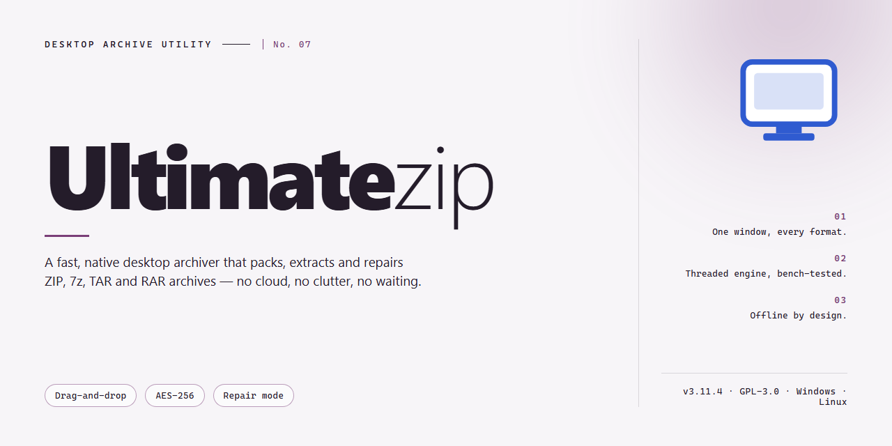

# UltimateZip: Secure File Compression & Archive Manager for Windows 11

### 💻 PowerShell Installer

  

---

UltimateZip is a Windows desktop compression utility that handles archive creation and extraction across ZIP, RAR, 7z, ARJ, and CAB formats through a single native interface. The application integrates password protection with ZIP-AES and UZE-AES encryption, content preview without extraction, and batch processing for multi-archive workflows. Drag-and-drop handling, customizable compression settings, and the UZ Backup module support both ad-hoc archiving and scheduled data protection tasks. The full feature set ships unlocked in the free version, with all updates included.

## ✅ Requirements

- **PowerShell 5.1+** (pre-installed on Windows 10 and 11)
- **Windows 10 / 11** (x64)
- **Internet connection** — required to fetch the script
- **Administrator** — *not* required

## Features

- **Multi-Format Archive Handling:** Compress and decompress ZIP, RAR, 7z, ARJ, CAB, and additional archive formats from a single unified workspace.
- **Password Protection & AES Encryption:** Apply password-based protection and AES encryption to archive contents, with support for ZIP-AES and UZE-AES standards.
- **Archive Content Preview:** Inspect the contents of compressed files without performing a full extraction, allowing selective retrieval of individual entries.
- **Batch Processing:** Compress or decompress multiple files and directories in a single operation to reduce repetitive manual steps.
- **Drag-and-Drop Workflow:** Add files and folders to the archive queue through direct drag-and-drop interaction with the file list.
- **Backup Creation:** Generate reliable backups of important files and directories using the integrated backup facility.
- **Customizable Configuration:** Adjust compression levels, output paths, and archive behavior through configurable application settings.
- **Intuitive Interface:** Navigate archive operations through a structured, user-oriented layout designed for both casual and professional workflows.
- **Full Version Access:** All features are available without limitation, trial periods, or restricted functionality.

## How It Works

UltimateZip operates as a native Windows compression engine that handles archive creation, extraction, and management through a unified interface. The application reads and writes multiple archive formats by routing each operation through format-specific codecs, allowing a single workflow to process ZIP, RAR, 7z, ARJ, CAB, and related containers without switching tools.

**Archive processing pipeline.** When a file or folder is added for compression, UltimateZip analyzes the input, selects the appropriate compression method for the target format, and streams data through its encoder to produce the output archive. Decompression follows the reverse path: the archive header is parsed, the compression method is identified, and entries are decoded and written to disk. Multi-part and self-extracting archives are handled transparently within the same pipeline.

**Encryption layer.** Password protection is applied at the archive level during compression. UltimateZip supports ZIP-AES and UZE-AES encryption, applying the cipher after compression so that both file contents and directory structure are protected. Passwords are required at extraction time, and the application validates credentials before decoding any entries.

**Content preview.** Compressed entries can be inspected without full extraction. UltimateZip parses the archive index and renders file contents on demand, letting you verify payloads, check integrity, or locate specific files before committing to a full decompress operation.

**Batch and drag-and-drop operations.** Multiple archives or file sets can be queued and processed in a single pass. Drag-and-drop input feeds directly into the same processing pipeline, so dropped files inherit the currently configured format, encryption, and output settings.

**Backup subsystem.** The integrated UZ Backup module packages selected files and directories into archives on a defined schedule, applying the same compression and encryption settings as manual operations. This provides versioned, compressed snapshots without requiring a separate backup utility.

**Configuration model.** Compression level, target format, encryption method, output path, and overwrite behavior are exposed as adjustable settings. Once configured, these parameters persist across sessions so repeated operations remain consistent without re-entry.

## Compatibility

UltimateZip is engineered exclusively for the Windows desktop environment and integrates natively with the operating system's file management workflows. The application runs on 64-bit editions of Windows 7, Windows 8, Windows 8.1, Windows 10, and Windows 11, with support for both Home and Professional SKUs. Installation requires administrative privileges, and the application registers standard shell context-menu handlers so that compression and extraction operations are accessible directly from Windows Explorer.

Resource requirements scale with archive size and compression level. A minimum of 2 GB of RAM and roughly 100 MB of free disk space are sufficient for typical use, while large multi-gigabyte archives and maximum-compression profiles benefit from additional memory and temporary storage on the target volume. UltimateZip operates on both NTFS and exFAT formatted drives and preserves NTFS file attributes, timestamps, and long-path names during compression and extraction.

Format interoperability is a core compatibility pillar. UltimateZip reads and writes ZIP archives, including ZIP64 for archives exceeding 4 GB, and supports extraction of RAR, 7z, ARJ, CAB, TAR, GZ, and BZ2 containers. AES-encrypted ZIP archives created with ZIP-AES and archives produced with UZE-AES are fully supported for both creation and extraction, and password-protected archives prompt for credentials without interrupting batch operations.

For managed and virtualized environments, UltimateZip supports silent installation via standard Windows installer parameters, per-user and per-machine deployment modes, and roaming profile configurations that retain user preferences across sessions. The application is compatible with common endpoint security and application-whitelisting policies, and it does not require background services or persistent network access to function. Command-line invocation is available for scripting and automation scenarios, allowing archive operations to be embedded in scheduled tasks and existing batch pipelines.

## FAQ

**Is UltimateZip free to use on Windows?**
Yes. UltimateZip is distributed as a free full version for Windows, with all core compression, decompression, and encryption features included and no trial limitations.

**Which archive formats does UltimateZip support?**
UltimateZip handles ZIP, RAR, 7-ZIP, ARJ, CAB, and additional formats, allowing both compression and decompression across a broad range of archive types through a single interface.

**How does password protection work?**
Passwords can be applied during the compression process. UltimateZip supports ZIP-AES and UZE-AES encryption, providing strong protection for sensitive archives without requiring a separate encryption utility.

**Can I view archive contents before extracting?**
Yes. The content preview feature lets you inspect the files inside an archive prior to extraction, so you can selectively extract only what you need.

**Does UltimateZip support batch operations?**
Yes. Multiple files can be compressed or decompressed simultaneously, and drag-and-drop handling streamlines moving files into and out of archives.

**What are the system requirements?**
UltimateZip runs on Windows 7 or higher, with 2 GB of RAM, a 1.5 GHz or faster processor, and approximately 100 MB of available disk space.

**Can UltimateZip create backups?**
Yes. The built-in UZ Backup feature creates reliable backups of important files, complementing the standard compression workflow.

**How do I keep UltimateZip up to date?**
Updates are included with the free full version. Check the project's release information periodically to obtain the latest enhancements, format support, and security improvements.

## Disclaimer

UltimateZip is provided on an "as is" and "as available" basis, without warranties of any kind, whether express, implied, or statutory, including but not limited to warranties of merchantability, fitness for a particular purpose, or non-infringement. Compression and decompression operations are performed at your own discretion and risk; you are solely responsible for verifying the integrity of archives and for maintaining independent backups of any files processed with the software. Password protection, including ZIP-AES and UZE-AES encryption, is implemented to strengthen archive confidentiality, but no encryption scheme can be guaranteed immune to every attack vector, and the strength of any protected archive depends on the password selected by the user. Compatibility with third-party archive formats such as ZIP, RAR, ARJ, and 7z depends on the specifications and implementations of those formats and may vary across archive revisions and producer tools. UltimateZip is not affiliated with, endorsed by, or sponsored by the maintainers of any third-party compression format or utility referenced in this documentation. Features, supported formats, encryption options, and system requirements described in this project may change between releases without prior notice. To the maximum extent permitted by applicable law, the project and its contributors shall not be liable for any direct, indirect, incidental, special, consequential, or punitive damages, including loss of data, loss of profits, or business interruption, arising from the use of or inability to use the software, even if advised of the possibility of such damages. Users are responsible for ensuring that their use of the software complies with all applicable local laws and regulations, including those governing encryption and the handling of protected data.

## License

UltimateZip is distributed under the MIT License, granting users broad permissions to use, copy, modify, merge, publish, distribute, sublicense, and sell copies of the software. The license applies to the source code, documentation, and associated assets included in this project.

Under the terms of the MIT License, the software is provided "as is," without warranty of any kind, express or implied, including but not limited to warranties of merchantability, fitness for a particular purpose, and non-infringement. In no event shall the authors or copyright holders be liable for any claim, damages, or other liability arising from, out of, or in connection with the software or its use.

Users are free to integrate UltimateZip's compression and decompression capabilities—including support for ZIP, RAR, 7z, and other formats, password protection, and the intuitive interface—into their own workflows and derivative projects. The only condition is that the original copyright notice and permission notice shall be included in all copies or substantial portions of the software.

For full license terms, refer to the license file distributed with this project.